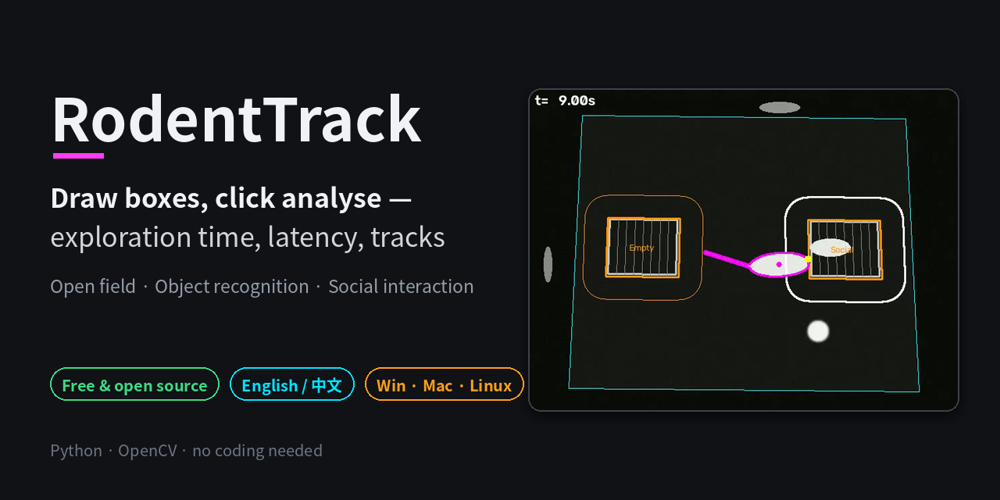
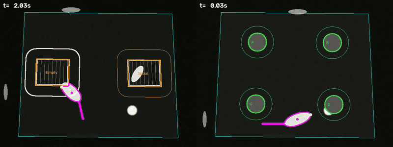
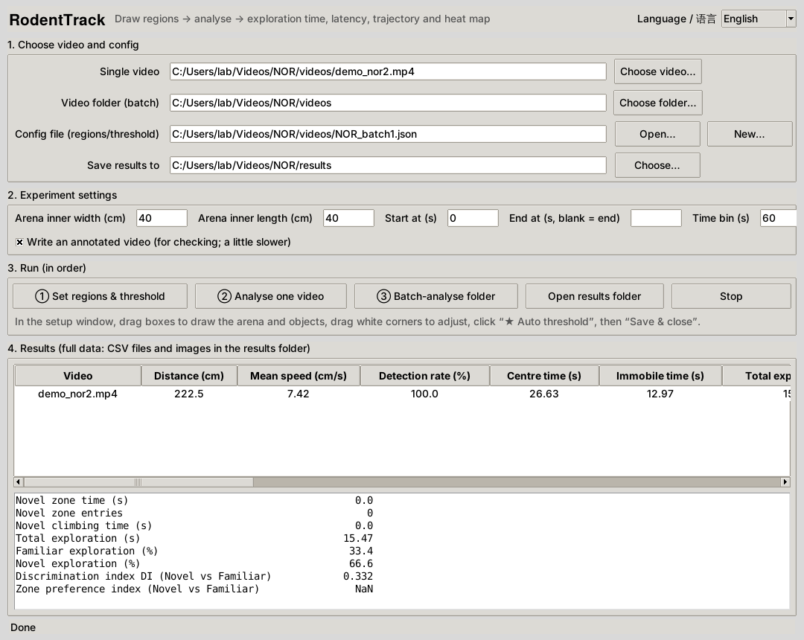
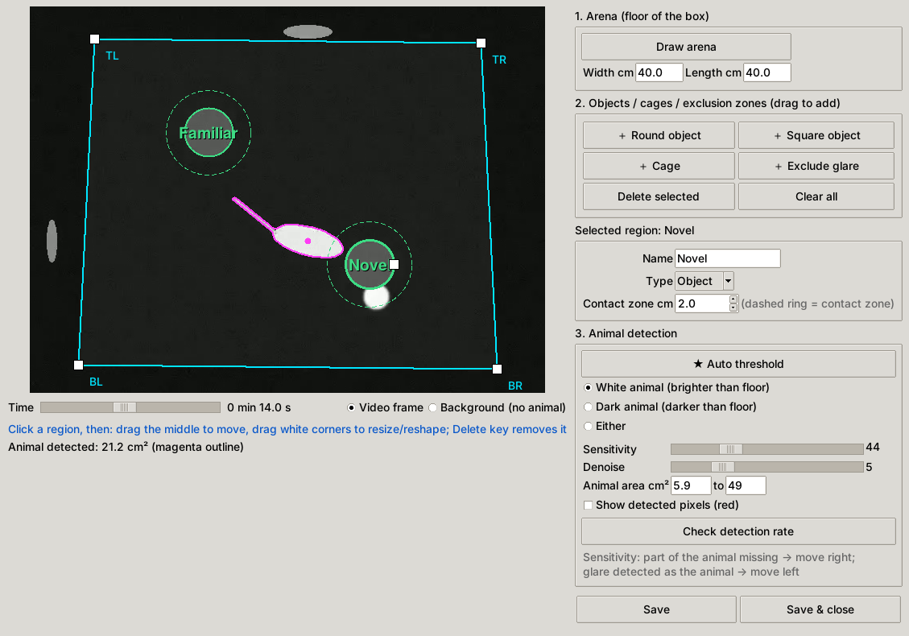
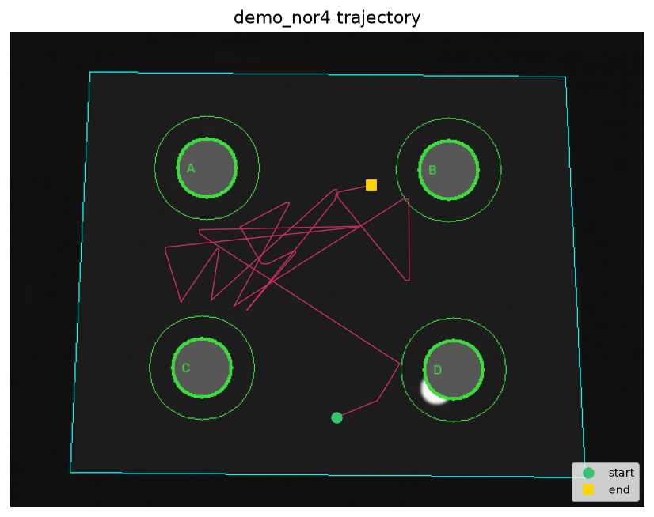
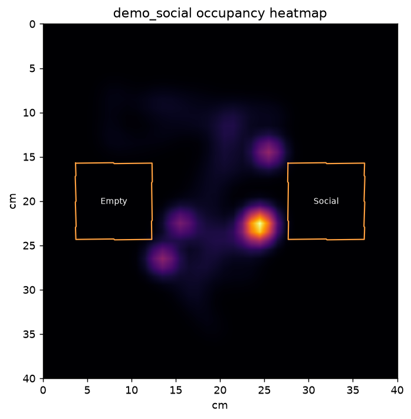
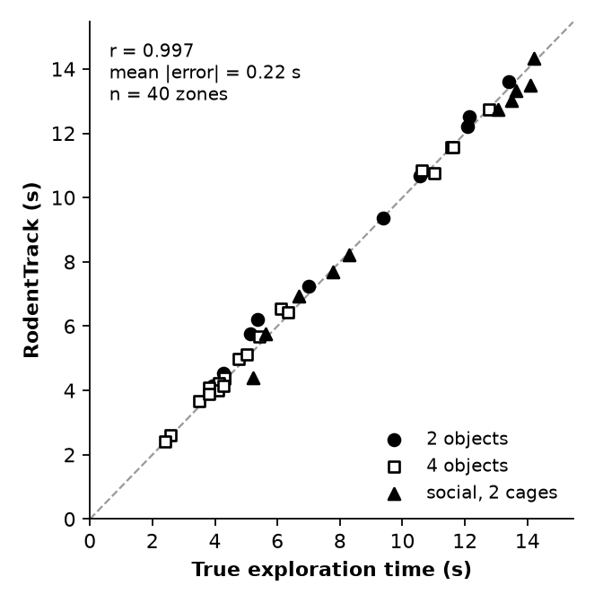

<div align="center">



# RodentTrack

**Point-and-click video tracking for rodent behaviour tests — no coding, no training data, no licence fee.**

Draw the arena and objects with the mouse, click once, and get exploration time, bouts, first-contact latency, discrimination index, trajectory and heat map for every video.

[](https://github.com/olliveryang-netizen/RodentTrack/actions/workflows/ci.yml)
[](LICENSE)


[](https://doi.org/10.5281/zenodo.24279287)

**English** · [中文说明](README.zh-CN.md) · [User guide](docs/USER_GUIDE.md) · [Methods text for papers](docs/METHODS.md)



<sub>Magenta: detected animal and body centre · yellow dot: nose · thin ring: contact zone (turns white while the animal explores).<br>Synthetic demo videos with known ground truth, included in <code>examples/demo</code>.</sub>

</div>

---

## Why RodentTrack?

Scoring object exploration with a stopwatch takes hours and differs between scorers. Commercial tracking systems are expensive, and pose-estimation tools need labelled frames and a GPU. RodentTrack sits in between: a small Python program that runs on an ordinary laptop and is set up in a few minutes.

| | Stopwatch | Commercial software | Pose estimation (DLC, SLEAP) | **RodentTrack** |
|---|:---:|:---:|:---:|:---:|
| Cost | free | licence | free | **free (MIT)** |
| Setup per experiment | none | minutes | label frames + train | **minutes, mouse only** |
| GPU needed | – | no | recommended | **no** |
| Same rule for every video | ✗ | ✓ | ✓ | **✓** |
| Nose-based exploration | by eye | ✓ | ✓ | **✓** |
| Open, checkable code | – | ✗ | ✓ | **✓** |

## Features

- 🖱️ **Mouse-only setup** — drag boxes for the arena, round/square objects, wire cages and glare zones; drag corners to fit a tilted camera (perspective-corrected, everything in cm).
- ⭐ **One-click threshold** — automatic threshold search plus a live preview of the detected animal on any frame.
- 👃 **Nose-based exploration** — counts a contact only when the nose is in the contact zone and the body is not on the object; climbing is reported separately. Optional head-direction rule.
- 📊 **Ready-to-use measures** — exploration time, bouts, first-contact latency, mean bout, % of total, discrimination index (DI), zone time/entries, distance, speed, centre time, immobility, per-minute time bins.
- 🧪 **Common tasks out of the box** — open field, novel object recognition, object location / 4 objects, two-cage social interaction (stimulus animal in the cage is masked).
- 📁 **Batch mode** — one config for a whole folder, one summary table; per-video configs when the camera moved.
- ✅ **Built-in checks** — trajectory plot, heat map, annotated video, detection rate for every video.
- 🌏 **English / 中文** — interface and result files in both languages.
- 💻 **Runs anywhere** — Windows, macOS, Linux; double-click launcher installs everything on first start.

## Screenshots

| Main window | Setup window |
|:---:|:---:|
|  |  |
| **Trajectory** (4 objects) | **Heat map** (social test) |
|  |  |

## Quick start

**1. Install Python 3.9+** from [python.org](https://www.python.org/downloads/) (Windows: tick *“Add python.exe to PATH”*).

**2. Download** this repository: green **Code** button → **Download ZIP** → unzip. Or:

```bash
git clone https://github.com/olliveryang-netizen/RodentTrack.git
```

**3. Double-click the launcher** — the first start installs the packages into a private `.venv` folder (1–3 min):

| Windows | macOS | Linux |
|---|---|---|
| `start_windows.bat` | `start_mac.command` | `bash start_linux.sh` |

**4. Try the demo**: choose `examples/demo/demo_nor2.mp4` and the config `examples/demo/demo_nor2.json`, then click **② Analyse one video**.

**5. Your own videos**: click **New…** to create a config → **① Set regions & threshold** → **② Analyse one video** → check the trajectory → **③ Batch-analyse folder**.

<details>
<summary><b>Command line</b></summary>

```bash
pip install -r requirements.txt
python mouse_tracker.py setup   video.mp4 -c nor.json --arena-w 40 --arena-h 40
python mouse_tracker.py analyze video.mp4 -c nor.json -o results --video
python mouse_tracker.py batch   videos/   -c nor.json -o results -r
python mouse_tracker.py --lang zh analyze video.mp4 -c nor.json   # Chinese output
```
</details>

## Output

| File | Content |
|---|---|
| `VIDEO_results.csv` | All measures with readable names (opens in Excel) |
| `VIDEO_time_bins.csv` | Distance, centre time, bouts and exploration time per time bin |
| `VIDEO_summary.csv` | Same measures, short column names for R / Python |
| `VIDEO_track.csv` | Frame-by-frame body centre and nose (px and cm), speed, exploration flags |
| `VIDEO_trajectory.png`, `VIDEO_heatmap.png` | Track over the background, occupancy heat map |
| `VIDEO_annotated.mp4` | Annotated video for checking |
| `summary_readable.csv`, `summary_all.csv` | Batch: one row per video |

Full list of measures and settings: [User guide](docs/USER_GUIDE.md#4-output-files).

## Accuracy

Tested on synthetic videos that imitate real recordings — tilted camera, a fixed glare spot, moving reflections on the wall, light flicker, pixel noise and a wire-mesh cage holding a live stimulus animal — against their known ground truth:

| Task | Videos (60 s) | Zones | Mean \|error\| | Max \|error\| | Body centre error | Nose error | Detection |
|---|:---:|:---:|:---:|:---:|:---:|:---:|:---:|
| 2 objects (NOR) | 5 | 10 | 0.30 s | 0.83 s | 0.06 cm | 0.21 cm | 100 % |
| 4 objects | 5 | 20 | 0.14 s | 0.43 s | 0.06 cm | 0.22 cm | 100 % |
| Social, 2 wire cages | 5 | 10 | 0.32 s | 0.83 s | 0.06 cm | 0.22 cm | 100 % |
| **All** | **15** | **40** | **0.22 s** | **0.83 s** | **0.06 cm** | **0.22 cm** | **100 %** |

Tracked vs true exploration time: r = 0.997 (mean true exploration time per zone 7.7 s; median relative error 2.4 %). The stimulus animal inside the wire cage was never taken for the test animal.



Reproduce it on your computer with `python examples/demo/validate.py`; the same checks run automatically on Windows, macOS and Linux for every commit (`tests/`). Real videos are harder than synthetic ones, so check the trajectory plot and annotated video of one or two videos per batch, and compare with manual scoring when you start using the tool.

## How it works

Median background subtraction → largest animal-sized blob inside the arena → tail removed by morphological opening → body centre and the two body ends → nose chosen from movement direction, tail position and continuity → exploration = nose in contact zone and body not on the object, bouts < 0.2 s removed. Details and a paragraph you can adapt for your Methods section: [docs/METHODS.md](docs/METHODS.md).

## Recording tips

Camera straight above the arena · diffuse light, no lamp shining on the floor · matte floor that contrasts with the animal · 720p–1080p, 25–30 fps. More in the [guide](docs/USER_GUIDE.md#7-glare-and-lighting).

## Citing

If RodentTrack helps your research, please cite it (GitHub: **“Cite this repository”** on the right, from [`CITATION.cff`](CITATION.cff)) and give the repository a ⭐ so others can find it.

## Contributing

Bug reports, new task templates and translations are welcome — see [CONTRIBUTING.md](CONTRIBUTING.md). Please do not upload unpublished experimental videos to issues; a screenshot is usually enough.

## License

[MIT](LICENSE) © 2026 Yuheng Yang, Department of Physiology, Yamaguchi University Graduate School of Medicine.
