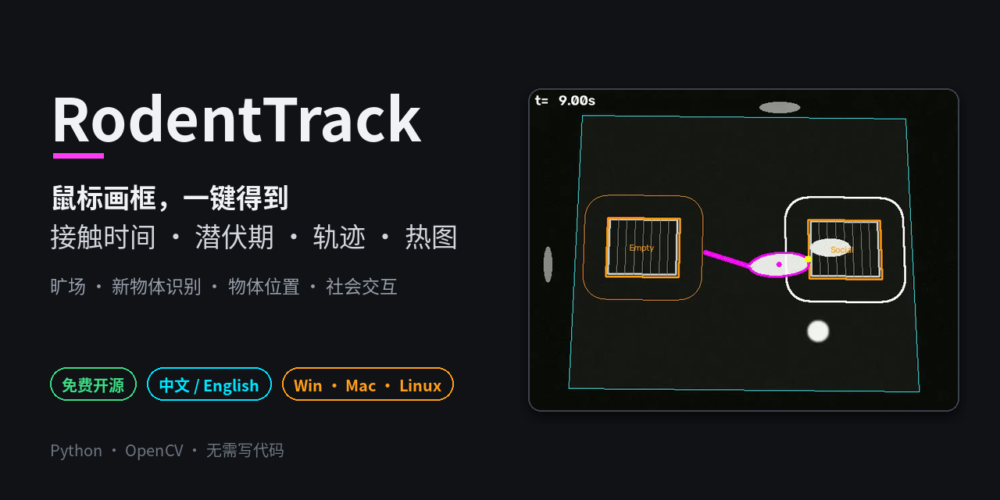
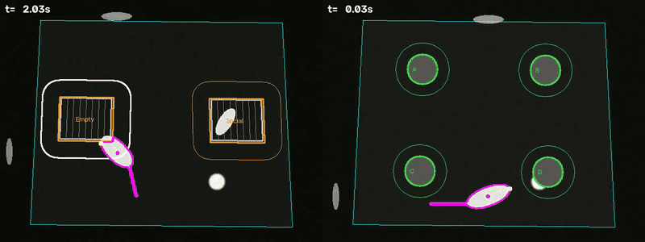
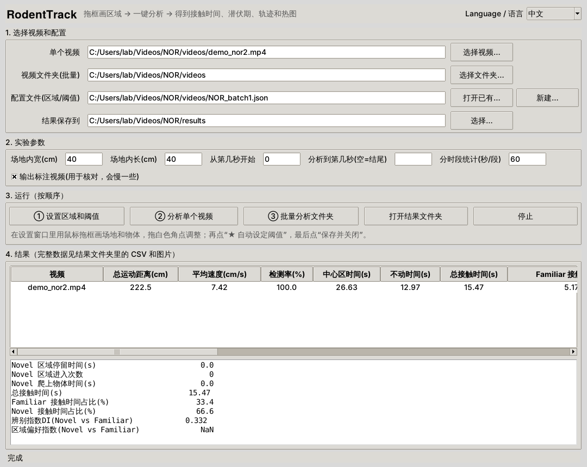
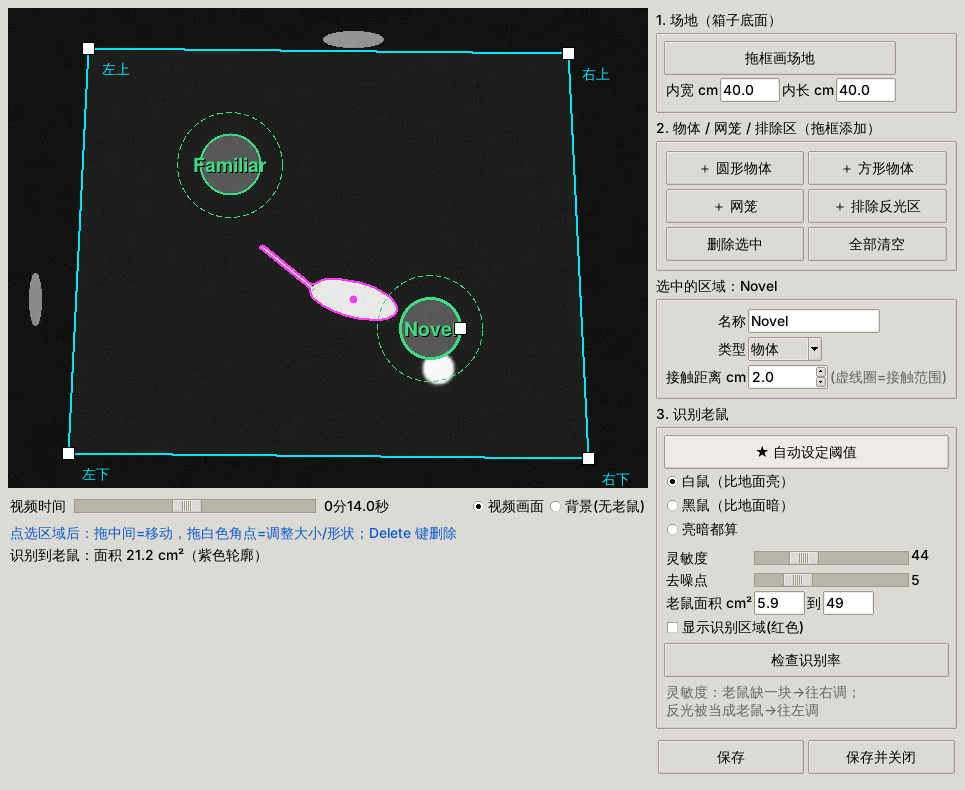
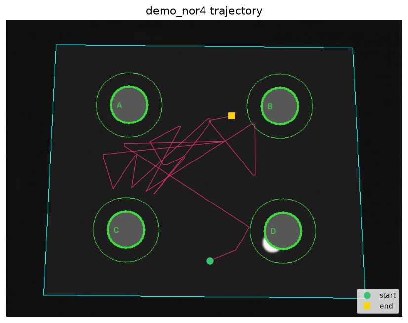
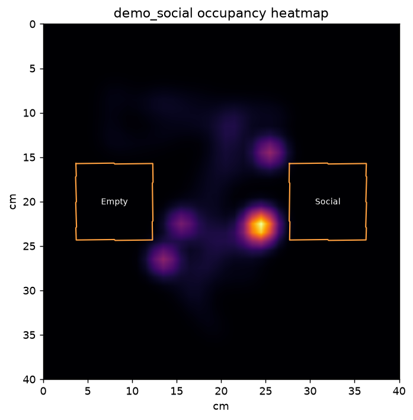
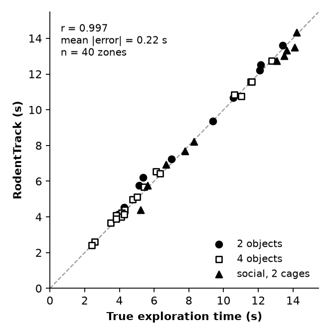

<div align="center">



# RodentTrack · 啮齿动物行为视频分析

**鼠标画框、一键分析 —— 不用写代码，不用标注训练，不用买软件。**

在视频上拖框画出场地和物体，点一下，就能得到每个视频的接触时间、接触次数、首次接触潜伏期、辨别指数、运动轨迹和热图。

[](https://github.com/olliveryang-netizen/RodentTrack/actions/workflows/ci.yml)
[](LICENSE)


[](https://doi.org/10.5281/zenodo.24279287)

[English](README.md) · **中文** · [使用说明](docs/USER_GUIDE.zh-CN.md) · [论文方法部分写法](docs/METHODS.md#中文论文方法部分可参考的写法)



<sub>紫色：识别出的动物和身体中心 · 黄点：鼻尖 · 细圈：接触范围（动物正在探索时变成白色）<br>演示视频为程序生成的模拟视频，真值已知，在 <code>examples/demo</code> 里。</sub>

</div>

---

## 为什么用 RodentTrack？

用秒表人工计时，一批视频要看好几个小时，而且不同的人计出来不一样；商业追踪软件很贵；姿态估计工具要先标注很多帧、最好有 GPU。RodentTrack 介于两者之间：一个普通笔记本就能跑的小程序，几分钟就能设置好。

| | 秒表人工计时 | 商业软件 | 姿态估计（DLC、SLEAP） | **RodentTrack** |
|---|:---:|:---:|:---:|:---:|
| 费用 | 免费 | 需要授权 | 免费 | **免费（MIT 开源）** |
| 每个实验的设置 | 无 | 几分钟 | 标注 + 训练 | **几分钟，只用鼠标** |
| 需要 GPU | – | 否 | 建议 | **否** |
| 所有视频同一标准 | ✗ | ✓ | ✓ | **✓** |
| 按鼻尖判断探索 | 靠眼睛 | ✓ | ✓ | **✓** |
| 代码公开可查 | – | ✗ | ✓ | **✓** |

## 功能

- 🖱️ **全鼠标设置** —— 拖框画场地、圆形 / 方形物体、网笼、反光排除区；镜头倾斜时拖四个角点即可校正（透视校正，全部换算成厘米）。
- ⭐ **一键自动阈值** —— 自动搜索阈值，任意一帧实时预览识别效果。
- 👃 **按鼻尖判断探索** —— 鼻尖进入接触范围、且身体不在物体上才算接触；爬上物体单独统计；可选“头朝向物体”规则。
- 📊 **指标直接可用** —— 接触时间、接触次数、首次接触潜伏期、平均每次接触、占比、辨别指数 DI、区域停留时间 / 进入次数、运动距离、速度、中心区时间、不动时间、每分钟分时段统计。
- 🧪 **常用范式开箱即用** —— 旷场、新物体识别、物体位置 / 4 物体、两网笼社会交互（网笼里的刺激鼠自动屏蔽）。
- 📁 **批量分析** —— 一个配置文件分析整个文件夹，输出一张汇总表；个别视频机位不同可单独配置。
- ✅ **自带核对** —— 每个视频都有轨迹图、热图、标注视频和检测率。
- 🌏 **中文 / English** —— 界面和结果文件都支持两种语言。
- 💻 **跨平台** —— Windows、macOS、Linux；双击启动文件，第一次自动安装所需组件。

## 截图

| 主窗口 | 设置窗口 |
|:---:|:---:|
|  |  |
| **轨迹图**（4 物体） | **热图**（社会交互） |
|  |  |

## 快速开始

**1. 安装 Python 3.9 以上版本**：[python.org](https://www.python.org/downloads/)（Windows 安装时勾选 *“Add python.exe to PATH”*）。

**2. 下载本软件**：点页面上绿色的 **Code** 按钮 → **Download ZIP** → 解压。或者：

```bash
git clone https://github.com/olliveryang-netizen/RodentTrack.git
```

**3. 双击启动文件** —— 第一次会自动把组件装进软件文件夹里的 `.venv`（约 1–3 分钟）：

| Windows | macOS | Linux |
|---|---|---|
| `start_windows.bat` | `start_mac.command` | `bash start_linux.sh` |

**4. 先试示例**：视频选 `examples/demo/demo_nor2.mp4`，配置选 `examples/demo/demo_nor2.json`，点 **② 分析单个视频**。

**5. 分析自己的视频**：点 **新建…** 建配置 → **① 设置区域和阈值** → **② 分析单个视频** → 看轨迹图确认 → **③ 批量分析文件夹**。

<details>
<summary><b>命令行用法</b></summary>

```bash
pip install -r requirements.txt
python mouse_tracker.py setup   视频.mp4 -c nor.json --arena-w 40 --arena-h 40
python mouse_tracker.py analyze 视频.mp4 -c nor.json -o results --video
python mouse_tracker.py batch   视频文件夹/ -c nor.json -o results -r
python mouse_tracker.py --lang en analyze 视频.mp4 -c nor.json   # 英文输出
```
</details>

## 输出

| 文件 | 内容 |
|---|---|
| `视频名_结果.csv` | 全部指标，中文列名（Excel 直接打开） |
| `视频名_分时段.csv` | 每个时段的运动距离、中心区时间、接触次数和接触时间 |
| `视频名_summary.csv` | 同样的指标，英文短列名（方便 R / Python） |
| `视频名_track.csv` | 逐帧身体中心和鼻尖坐标（像素和 cm）、速度、是否在探索 |
| `视频名_trajectory.png`、`视频名_heatmap.png` | 轨迹图、位置热图 |
| `视频名_annotated.mp4` | 标注视频，用来核对 |
| `汇总结果.csv`、`summary_all.csv` | 批量分析：每个视频一行 |

全部指标和参数说明见 [使用说明](docs/USER_GUIDE.zh-CN.md#四结果文件)。

## 准确度

用模拟真实拍摄条件的视频（镜头倾斜、地面固定光斑、箱壁上随动物移动的倒影、灯光闪烁、像素噪声、网笼里有活体刺激鼠）与已知真值对比：

| 实验 | 视频（60 s） | 区域数 | 平均绝对误差 | 最大误差 | 身体中心误差 | 鼻尖误差 | 检测率 |
|---|:---:|:---:|:---:|:---:|:---:|:---:|:---:|
| 2 物体（新物体识别） | 5 | 10 | 0.30 s | 0.83 s | 0.06 cm | 0.21 cm | 100% |
| 4 物体 | 5 | 20 | 0.14 s | 0.43 s | 0.06 cm | 0.22 cm | 100% |
| 社会交互（2 个网笼） | 5 | 10 | 0.32 s | 0.83 s | 0.06 cm | 0.22 cm | 100% |
| **合计** | **15** | **40** | **0.22 s** | **0.83 s** | **0.06 cm** | **0.22 cm** | **100%** |

追踪得到的接触时间与真值相关 r = 0.997（每个区域的真实接触时间平均 7.7 s，相对误差中位数 2.4%）。网笼里的刺激鼠没有一次被误认成实验鼠。



在自己电脑上运行 `python examples/demo/validate.py` 就能重复；每次提交代码时，GitHub 也会在 Windows、macOS、Linux 上自动跑一遍测试（`tests/`）。真实视频比模拟视频复杂，**每批实验先检查一两个视频的轨迹图和标注视频，刚开始使用时最好和人工计时对照一下**。

## 原理

中位数背景相减 → 场地内面积合适的最大目标 → 形态学开运算去掉尾巴 → 身体中心和身体两端 → 根据运动方向、尾巴位置和前后帧连续性判断鼻尖 → 鼻尖在接触范围内且身体不在物体上 = 探索，短于 0.2 s 的不计。详细说明和论文方法部分的参考写法：[docs/METHODS.md](docs/METHODS.md)。

## 拍摄建议

摄像头正上方垂直拍摄 · 漫射光，不要让灯直射底面 · 哑光、和动物颜色反差大的箱底 · 720p–1080p、25–30 fps 足够。更多见 [使用说明](docs/USER_GUIDE.zh-CN.md#七反光与光照处理思路)。

## 引用

如果 RodentTrack 对你的研究有帮助，请引用（GitHub 页面右侧 **“Cite this repository”**，来自 [`CITATION.cff`](CITATION.cff)），也欢迎点个 ⭐ Star，让更多同行看到。

## 参与改进

欢迎提交问题、新的实验范式模板和翻译，见 [CONTRIBUTING.md](CONTRIBUTING.md)。提问时请不要上传未发表的实验视频，一张截图通常就够了。

## 许可

[MIT](LICENSE) © 2026 Yuheng Yang（楊 宇恒，[ORCID 0009-0006-4374-2030](https://orcid.org/0009-0006-4374-2030)），山口大学大学院医学系研究科 生理学讲座。
