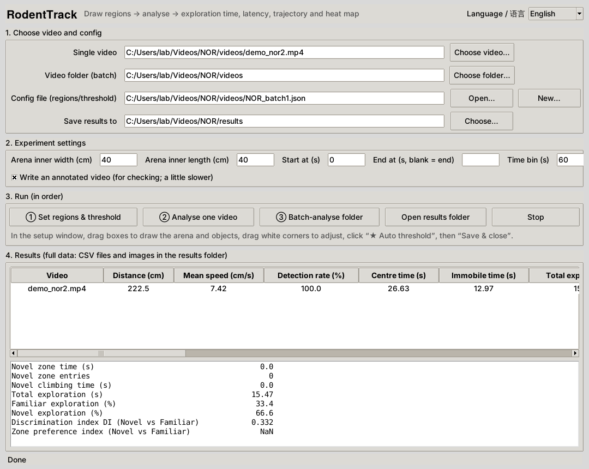
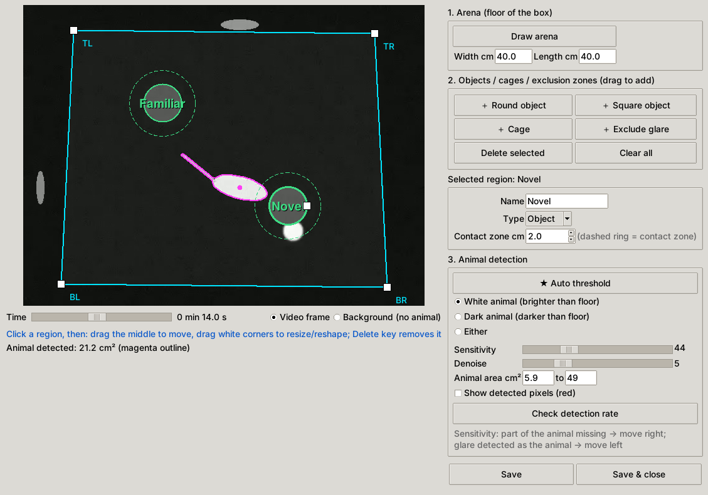
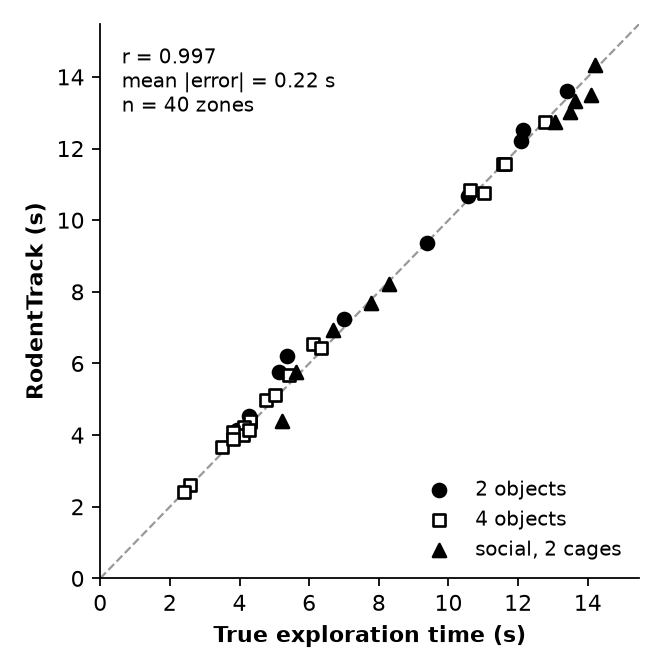

# RodentTrack user guide

**English** | [中文](USER_GUIDE.zh-CN.md)

For: novel object recognition (2 objects), multi-object exploration / object location (4 objects), two-cage social interaction (live stimulus animal inside a wire cage) and open-field centre time. Video formats: mp4, mov, avi, m4v, mkv.

- [1. Install](#1-install-once)
- [2. Main window](#2-main-window-recommended)
- [3. Setup window](#3-setup-window)
- [4. Output files](#4-output-files)
- [5. Command line](#5-command-line)
- [6. Config file](#6-config-file-json)
- [7. Glare and lighting](#7-glare-and-lighting)
- [8. FAQ](#8-faq)
- [9. Validation](#9-validation)

---

## 1. Install (once)

1. Install **Python 3.9 or newer** from <https://www.python.org/downloads/>
   - Windows: tick **“Add python.exe to PATH”** in the installer.
   - macOS: use the python.org installer (it includes tkinter). With Homebrew, also run `brew install python-tk`.
   - Ubuntu / Debian: `sudo apt install python3 python3-venv python3-tk`
2. Download RodentTrack: on the GitHub page click the green **Code → Download ZIP** and unzip it anywhere.
3. **Double-click the launcher**:

| System | Double-click |
|---|---|
| Windows | `start_windows.bat` |
| macOS | `start_mac.command` (if macOS refuses the first time: right-click → Open, or run `bash start_mac.command` in Terminal) |
| Linux | run `bash start_linux.sh` in a terminal |

On first start the launcher creates a private environment (`.venv`) inside the RodentTrack folder and installs OpenCV, numpy, pandas and matplotlib (internet needed, 1–3 min). Later starts open the window straight away.

> Without the launcher: open a terminal in the folder, run `pip install -r requirements.txt`, then `python mouse_tracker_gui.py`. You can also open `mouse_tracker.py` in IDLE and press **F5**.

---

## 2. Main window (recommended)



1. Switch **English / 中文** in the top-right corner (interface and result column names change together).
2. **Choose video…** (one video) or **Choose folder…** (batch).
3. Config file: the first time, click **New…** and give it a name (e.g. `NOR_batch1.json`); for later experiments with the same layout, click **Open…**.
4. Enter the arena inner width and length (cm), the start and end time (blank = end of video) and the time-bin length (60 = per minute).
5. Click **① Set regions & threshold** to open the setup window (mouse only, see below).
6. Click **② Analyse one video**, check the trajectory plot and annotated video in the results folder, then click **③ Batch-analyse folder**.
7. Results appear in the table; **Open results folder** shows every CSV file and image.

The window remembers what you entered last time. If the setup window does not appear, click the Python icon in the taskbar (Windows) or Dock (Mac).

> **Try it first**: choose `examples/demo/demo_nor2.mp4` with the config `examples/demo/demo_nor2.json` and click ②. The demo videos are synthetic; their true exploration times are in the matching `.truth.json` file.

---

## 3. Setup window



| Task | How |
|---|---|
| Draw the arena | Click “Draw arena” and **drag a box** around the arena floor. If the camera is tilted, drag each of the 4 **white corners** onto the floor corners (used for perspective correction and conversion to cm) |
| Add objects / cages | Click “＋ Round object”, “＋ Square object” or “＋ Cage”, then drag a box around it |
| Move / resize | Click a region to select it: drag the middle to move, drag white corners to resize |
| Rename | Select it and edit “Name” on the right, e.g. Novel / Familiar, Social / Empty |
| Contact zone | The **dashed ring** is the contact zone: 2 cm for objects and 3 cm for cages by default, editable on the right |
| Ignore glare | Click “＋ Exclude glare” and box glare outside the arena or very small bright spots (the animal is not detected inside, so keep it small) |
| Delete | Select and click “Delete selected”, or press Delete |
| Threshold | Click “★ Auto threshold”, then drag the time bar and check a few frames: the **magenta outline should just cover the animal** |
| Fine-tune | Part of the animal missing → move “Sensitivity” right; glare detected → move left. “Show detected pixels” marks them in red |
| Check | “Check detection rate” samples 40 frames; aim for ≥ 95 % (frames of the empty arena before the animal is placed count too) |
| Finish | Click “Save & close” |

---

## 4. Output files

All files open directly in Excel (UTF-8 with BOM).

| File | Content |
|---|---|
| `VIDEO_results.csv` | All measures with readable names: distance, speed, and for every object the **bouts, exploration time, first-contact latency**, mean bout, discrimination index … |
| `VIDEO_time_bins.csv` | Per time bin (e.g. per minute): distance, centre time, bouts and exploration time per object |
| `VIDEO_summary.csv` | The same measures with short machine-readable names (for R / Python) |
| `VIDEO_track.csv` | Frame by frame: time, body centre and nose (px and cm), speed, exploration flag per object |
| `VIDEO_trajectory.png` | Track over the background — **look at this first to check regions and detection** |
| `VIDEO_heatmap.png` | Occupancy heat map (cm) |
| `VIDEO_background.png` | The computed background (if it shows the animal, see FAQ) |
| `VIDEO_annotated.mp4` | Annotated video (when “Write an annotated video” is ticked) |
| `summary_readable.csv` / `summary_all.csv` | Batch mode: one row per video (readable / short names) |

With 中文 selected, the readable files are `_结果.csv`, `_分时段.csv` and `汇总结果.csv`.

Main measures:

| Column (`summary`) | Column (`results`) | Meaning |
|---|---|---|
| `detect_rate_%` | Detection rate (%) | Frames in which the animal was found; should be > 95 % |
| `distance_cm`, `mean_speed_cm_s` | Distance, Mean speed | |
| `center_time_s`, `center_entries` | Centre time, Centre entries | Open field; centre = 50 % of the side by default |
| `immobile_time_s` | Immobile time | Speed < 2 cm/s for ≥ 1 s |
| `X_explore_s` | X exploration time | **Nose inside the contact zone while the body centre is not on the object** (climbing does not count) |
| `X_explore_bouts`, `X_explore_latency_s`, `X_mean_bout_s` | bouts, first-contact latency, mean bout | Bouts < 0.2 s are dropped; gaps < 0.2 s are merged |
| `X_zone_s`, `X_zone_entries` | zone time, zone entries | Body centre inside the contact zone (common for social tests) |
| `X_on_top_s` | climbing time | |
| `X_explore_%` | exploration (%) | Share of total exploration (4-object tests) |
| `DI_B_vs_A` | Discrimination index DI (B vs A) | (B − A) / (B + A) from exploration time |
| `zoneIndex_B_vs_A` | Zone preference index | Same from zone time (social preference index) |

---

## 5. Command line

Same functions as the window, useful for scripts.

```
setup (regions & threshold) → analyze one video → check the trajectory / annotated video → batch
```

```bash
python mouse_tracker.py setup   video.mp4 -c nor.json --arena-w 40 --arena-h 40
python mouse_tracker.py analyze video.mp4 -c nor.json -o results --video
python mouse_tracker.py batch   D:/videos -c nor.json -o results -r
python mouse_tracker.py --lang zh analyze video.mp4 -c nor.json     # Chinese output
```

- `--arena-w / --arena-h`: real inner width and length of the arena **floor** (cm).
- `--video`: also write the annotated video (leave it out in batch mode for speed).
- `batch` processes every video in the folder; `-r` includes sub-folders.
- If the camera and arena do not move, **one config file works for the whole batch**. For a video filmed from a different position, put a **.json with the same name** next to it (e.g. `mouse07.json` next to `mouse07.mov`); that video then uses its own config.

---

## 6. Config file (JSON)

Open the JSON in any text editor.

**Names** (recommended; makes the tables readable): change `"name": "Obj2"` to `"Novel"`, `"Cage1"` to `"Empty"`, etc.

**Pairs to compare** (automatic with 2 zones; needed with 4):

```json
"comparisons": [["Familiar", "Novel"], ["Empty", "Social"]]
```

This gives `DI_Novel_vs_Familiar` = (Novel − Familiar) / (Novel + Familiar).

**analysis**:

| Key | Default | Meaning |
|---|---|---|
| `start_s` | 0 | Start time (skip placing the animal and closing the lid) |
| `end_s` | null | End time, e.g. 300 = first 5 min (null = end of video) |
| `min_bout_s` | 0.2 | Shorter contacts are not counted |
| `merge_gap_s` | 0.2 | Contacts separated by less than this are merged |
| `exclude_climbing` | true | Climbing on the object is not exploration |
| `heading_deg` | null | e.g. 45: the head must point at the object within ±45° (stricter) |
| `center_ratio` | 0.5 | Centre zone as a fraction of the side |
| `immobile_speed_cm_s` / `immobile_min_s` | 2.0 / 1.0 | Immobility speed threshold and minimum duration |
| `fps_override` | null | Set by hand if a phone video reports a wrong frame rate |
| `bin_s` | 60 | Time-bin length (s) |

**detection**: holds the threshold saved by the setup window. `exclude_cages: true` masks the inside of wire cages so the stimulus animal is never taken for the test animal; `body_open_cm` is 1.0 for mice and about 2.0 for rats; `proc_width` is the width frames are scaled to before analysis (default 960: fast and accurate enough).

---

## 7. Glare and lighting

Detection is based on **background subtraction**: 50 frames spread over the video are combined by a median into a background image. The moving animal disappears from it, while **fixed** glare, light spots, objects and cages stay, so they cancel out after subtraction.

| Problem | Fix |
|---|---|
| Fixed light spots on the floor | Removed automatically; if some remains, move Sensitivity left |
| Moving **reflection** of the animal on glossy walls | The arena corners are on the **floor**, so wall reflections lie outside and are ignored; at the floor edge, draw an exclusion zone or raise the minimum area |
| Saturated glare (near 255): the animal “vanishes” on it | Dim or diffuse the light, or exclude the spot |
| One side bright, the other dark | Set `clahe` to true |
| Flickering fluorescent light | Increase `blur`, move Sensitivity slightly left; LED DC lighting is best |
| Reflections on the cage wire | The cage interior is masked by default; draw cages slightly larger than they are |
| Dark animal / white floor | Choose “Dark animal (darker than floor)” |

**Recording tips** (more effective than tuning): camera straight above the arena; diffuse light, no lamp pointing at the floor; matte floor; 720p–1080p and 25–30 fps are enough.

---

## 8. FAQ

- **The background image shows the animal**: it stayed still for a long time. Raise `bg_frames` to 100, restrict `start_s` / `end_s` to an active period, or record a short empty-arena clip for setup.
- **Low detection rate**: in the setup window go to the frames where it was lost and move Sensitivity right, or click Auto threshold again.
- **Nose occasionally placed on the tail**: head and tail are decided from the direction of movement, the end where the tail is, and continuity with the previous frame. When nose precision is critical, run DeepLabCut / SLEAP pose estimation and use RodentTrack’s zone logic on the key points.
- **Animal climbs onto a cage**: the cage interior is masked, so the animal is missing during that time. If it happens often, set `exclude_cages` to false and use stimulus and test animals of different colours.
- **iPhone .mov will not open**: probably HEVC. Convert: `ffmpeg -i in.mov -c:v libx264 -crf 20 out.mp4`.
- **Windows: the .bat window closes immediately**: type `cmd` in the folder’s address bar, press Enter, then run `start_windows.bat` to read the message.
- **macOS: “unidentified developer”**: right-click → Open → Open, or run `bash start_mac.command` in Terminal.
- **Change the language**: the language box in the main window; `--lang en` / `--lang zh` on the command line; or the environment variable `RODENTTRACK_LANG`.

---

## 9. Validation

Synthetic videos (tilted camera, a fixed glare spot, moving reflections on the wall, flicker, a wire-mesh cage holding a live stimulus animal) are compared with their ground truth. Anyone can repeat this:

```bash
python examples/demo/validate.py          # 3 tasks × 5 random seeds, 60 s each
python -m pytest -q tests                 # automated tests (run on Windows / macOS / Linux for every commit on GitHub)
```

| Task | Videos (60 s) | Zones | Mean \|error\| | Max \|error\| | Body centre error | Nose error | Detection |
|---|:---:|:---:|:---:|:---:|:---:|:---:|:---:|
| 2 objects (NOR) | 5 | 10 | 0.30 s | 0.83 s | 0.06 cm | 0.21 cm | 100 % |
| 4 objects | 5 | 20 | 0.14 s | 0.43 s | 0.06 cm | 0.22 cm | 100 % |
| Social, 2 wire cages | 5 | 10 | 0.32 s | 0.83 s | 0.06 cm | 0.22 cm | 100 % |
| **All** | **15** | **40** | **0.22 s** | **0.83 s** | **0.06 cm** | **0.22 cm** | **100 %** |

Tracked vs true exploration time: r = 0.997 (mean true exploration time per zone 7.7 s; median relative error 2.4 %). The stimulus animal inside the wire cage was never taken for the test animal.



Real videos have more complex lighting and animal appearance. **For every batch, check the trajectory plot and annotated video of 1–2 videos first, and compare with manual scoring where needed.**
