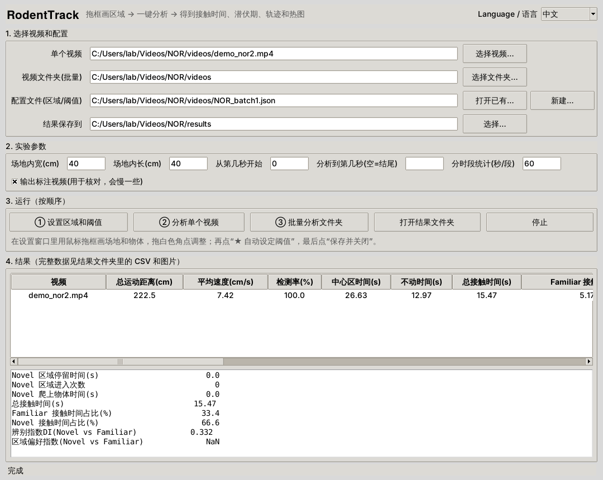
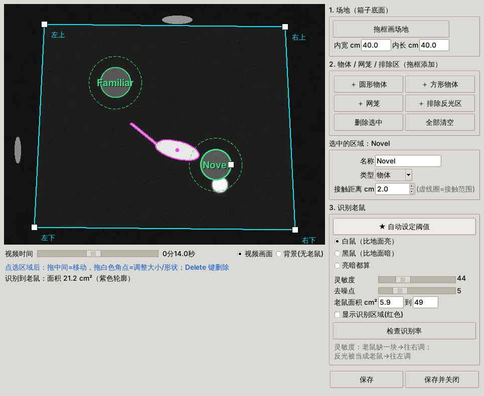
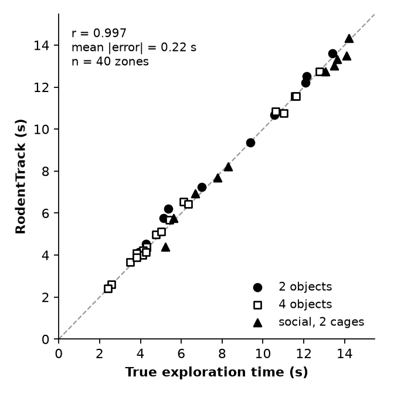

# RodentTrack 使用说明

[English](USER_GUIDE.md) | **中文**

适用于：新物体识别（2 个物体）、多物体探索 / 物体位置（4 个物体）、网笼社会交互（网笼里放活体刺激鼠）、旷场中心时间。支持 mp4、mov、avi、m4v、mkv。

- [一、安装](#一安装只需一次)
- [二、图形界面（推荐）](#二图形界面推荐)
- [三、设置窗口](#三设置窗口怎么用)
- [四、结果文件](#四结果文件)
- [五、命令行用法](#五命令行用法)
- [六、配置文件里常改的地方](#六配置文件json里常改的地方)
- [七、反光与光照](#七反光与光照处理思路)
- [八、常见问题](#八常见问题)
- [九、验证](#九验证)

---

## 一、安装（只需一次）

1. 安装 **Python 3.9 或更新版本**：<https://www.python.org/downloads/>
   - Windows：安装界面**勾选 “Add python.exe to PATH”**。
   - macOS：用 python.org 的安装包（自带 tkinter 图形库）。用 Homebrew 的话再装 `brew install python-tk`。
   - Ubuntu / Debian：`sudo apt install python3 python3-venv python3-tk`
2. 下载本软件：GitHub 页面上点绿色 **Code → Download ZIP**，解压到任意文件夹（路径里最好不要有空格以外的特殊符号）。
3. **双击启动文件**：

| 系统 | 双击这个文件 |
|---|---|
| Windows | `start_windows.bat` |
| macOS | `start_mac.command`（第一次如提示“无法打开”，右键 → 打开；或在终端运行 `bash start_mac.command`） |
| Linux | 终端运行 `bash start_linux.sh` |

第一次启动会自动在软件文件夹里建一个独立的运行环境 `.venv` 并安装 OpenCV、numpy、pandas、matplotlib（需要联网，约 1–3 分钟）。以后再双击就直接打开。

> 不想用启动文件也可以：在软件文件夹打开终端，运行 `pip install -r requirements.txt`，然后 `python mouse_tracker_gui.py`；或者在 IDLE 里打开 `mouse_tracker.py` 按 **F5**。

---

## 二、图形界面（推荐）



1. 右上角可以切换 **中文 / English**（界面和结果文件的列名一起切换）。
2. **选择视频…**（分析单个）或 **选择文件夹…**（批量）。
3. 配置文件：第一次点 **新建…** 起个名字（例如 `NOR第1批.json`）；以后同样摆放的实验点 **打开已有…**。
4. 填写场地内宽、内长（cm），从第几秒开始、分析到第几秒（空 = 到结尾），分时段统计每段几秒（60 = 每分钟）。
5. 点 **① 设置区域和阈值**，打开设置窗口（全部用鼠标操作，见下节）。
6. 点 **② 分析单个视频**，打开结果文件夹看轨迹图和标注视频，确认没问题后再点 **③ 批量分析文件夹**。
7. 结果显示在窗口下方的表格里；点 **打开结果文件夹** 可以看全部 CSV 和图片。

窗口会记住上次填写的内容。设置窗口打开后如果没看到，请在任务栏（Windows）或程序坞（Mac）里点 Python 图标。

> **先试一下**：选择 `examples/demo/demo_nor2.mp4`，配置选 `examples/demo/demo_nor2.json`，直接点 ②，就能看到完整结果。示例视频是程序生成的模拟视频，真值写在同名 `.truth.json` 里。

---

## 三、设置窗口怎么用



| 要做的事 | 操作 |
|---|---|
| 画场地 | 点“拖框画场地”，在画面上**按住鼠标拖一个框**框住箱子底面。镜头有点斜时，分别拖 4 个**白色角点**对准底面四角（程序据此做透视校正，换算成厘米） |
| 加物体 / 网笼 | 点“＋ 圆形物体”“＋ 方形物体”或“＋ 网笼”，再拖一个框框住它 |
| 调整位置、大小 | 点一下区域选中：拖中间 = 移动，拖白色角点 = 调整大小 |
| 改名字 | 选中后在右边“名称”里改，例如 Novel / Familiar、Social / Empty |
| 接触范围 | 区域外的**虚线圈**就是接触范围，物体默认 2 cm、网笼默认 3 cm，可在右边改 |
| 忽略反光 | 点“＋ 排除反光区”，框住场地外或很小的亮斑（动物走进排除区时不会被识别，不要框太大） |
| 删除 | 选中后点“删除选中”或按 Delete 键 |
| 设定阈值 | 点“★ 自动设定阈值”；然后拖动下方“视频时间”条看几帧，**紫色轮廓刚好包住动物**就对了 |
| 微调 | 动物缺一块 → “灵敏度”往右调；反光被当成动物 → 往左调。勾选“显示识别区域”可以看到被识别的像素（红色） |
| 检查 | 点“检查识别率”，抽查 40 帧，应 ≥ 95%（开头放鼠前的空箱画面也算在内） |
| 完成 | 点“保存并关闭” |

---

## 四、结果文件

都可以直接用 Excel 打开（UTF-8 带 BOM，中文不会乱码）。

| 文件 | 内容 |
|---|---|
| `视频名_结果.csv` | 全部指标（中文列名）：总运动距离、平均速度、每个物体的**接触次数、接触时间、首次接触潜伏期**、平均每次接触时长、辨别指数等 |
| `视频名_分时段.csv` | 每个时段（如每分钟）的运动距离、中心区时间、每个物体的接触次数和接触时间 |
| `视频名_summary.csv` | 同样的指标，英文列名（方便 R / Python 统计） |
| `视频名_track.csv` | 逐帧数据：时间、身体中心和鼻尖坐标（像素 / cm）、速度、每帧是否在探索各物体 |
| `视频名_trajectory.png` | 轨迹叠加在背景上 —— **先看这张图检查标记和检测是否正确** |
| `视频名_heatmap.png` | 位置热图（厘米坐标） |
| `视频名_background.png` | 生成的背景（里面如果有动物，说明它长时间不动，见常见问题） |
| `视频名_annotated.mp4` | 标注视频（勾选“输出标注视频”时） |
| `汇总结果.csv` / `summary_all.csv` | 批量分析时，所有视频一行一个（中文 / 英文列名），方便做统计 |

选择 English 时，中文文件名对应为 `_results.csv`、`_time_bins.csv`、`summary_readable.csv`。

主要指标：

| 英文列名 | 中文列名 | 含义 |
|---|---|---|
| `detect_rate_%` | 检测率(%) | 检测到动物的帧比例，应 > 95% |
| `distance_cm`, `mean_speed_cm_s` | 总运动距离、平均速度 | |
| `center_time_s`, `center_entries` | 中心区时间、进入次数 | 旷场；中心区默认占边长 50% |
| `immobile_time_s` | 不动时间 | 速度 < 2 cm/s 持续 ≥ 1 s |
| `X_explore_s` | X 接触时间 | **鼻尖进入接触范围，且身体中心不在物体上**（爬上物体不算） |
| `X_explore_bouts`, `X_explore_latency_s`, `X_mean_bout_s` | 接触次数、首次接触潜伏期、平均每次接触 | 短于 0.2 s 的接触不计，间隔 < 0.2 s 的合并 |
| `X_zone_s`, `X_zone_entries` | 区域停留时间、进入次数 | 身体中心在接触范围内（社会交互常用） |
| `X_on_top_s` | 爬上物体时间 | |
| `X_explore_%` | 接触时间占比 | 4 物体实验用 |
| `DI_B_vs_A` | 辨别指数DI(B vs A) | (B − A) / (B + A)，基于接触时间 |
| `zoneIndex_B_vs_A` | 区域偏好指数 | 同上，基于区域停留时间（社会偏好指数） |

---

## 五、命令行用法

功能和图形界面完全一样，适合批量脚本。

```
setup（设置区域和阈值） → analyze 先试一个视频 → 检查轨迹图 / 标注视频 → batch 批量
```

```bash
python mouse_tracker.py setup   视频.mp4 -c nor.json --arena-w 40 --arena-h 40
python mouse_tracker.py analyze 视频.mp4 -c nor.json -o results --video
python mouse_tracker.py batch   D:/实验视频 -c nor.json -o results -r
python mouse_tracker.py --lang en analyze 视频.mp4 -c nor.json     # 英文输出
```

- `--arena-w / --arena-h` 是箱子**底面内侧**的实际长宽（cm）。
- `--video` 额外输出标注视频（批量时可不加，更快）。
- `batch` 自动处理文件夹里所有视频，`-r` 包括子文件夹。
- 同一批实验摄像头和箱子位置不动时，**一个配置文件就能用于全部视频**。某个视频机位不同时，在视频旁放一个**同名 .json**（如 `mouse07.mov` 旁边放 `mouse07.json`），该视频会自动用自己的配置。

---

## 六、配置文件（JSON）里常改的地方

用记事本打开 JSON：

**改名字**（建议，结果表更好读）：`"name": "Obj2"` 改成 `"Novel"`，`"Cage1"` 改成 `"Empty"` 等。

**要比较的配对**（2 个区域时自动计算，4 个时需要指定）：

```json
"comparisons": [["Familiar", "Novel"], ["Empty", "Social"]]
```

结果为 `DI_Novel_vs_Familiar` = (Novel − Familiar) / (Novel + Familiar)。

**analysis 部分**：

| 参数 | 默认 | 说明 |
|---|---|---|
| `start_s` | 0 | 从第几秒开始（跳过放鼠、关门） |
| `end_s` | null | 分析到第几秒，如 300 = 前 5 分钟（null = 到结尾） |
| `min_bout_s` | 0.2 | 短于此的接触不算 |
| `merge_gap_s` | 0.2 | 间隔短于此的两次接触合并为一次 |
| `exclude_climbing` | true | 爬上物体不算探索 |
| `heading_deg` | null | 设为 45 则要求头朝向物体 ±45° 才算探索（更严格） |
| `center_ratio` | 0.5 | 中心区占边长比例 |
| `immobile_speed_cm_s` / `immobile_min_s` | 2.0 / 1.0 | 不动的速度阈值和最短持续时间 |
| `fps_override` | null | 手机视频帧率读不准时手动填写 |
| `bin_s` | 60 | 分时段统计每段秒数 |

**detection 部分**：设置窗口保存的阈值都在这里。`exclude_cages: true` 表示检测时屏蔽网笼内部，网笼里的刺激鼠不会被误认成实验鼠；`body_open_cm` 小鼠 1.0、大鼠可设 2.0；`proc_width` 是分析前缩放到的宽度（默认 960，速度快且精度足够）。

---

## 七、反光与光照处理思路

核心是**背景相减**：从整段视频均匀抽 50 帧取中位数作为背景。动物在移动，所以背景里没有它；而**固定的**反光、光斑、物体、网笼都在背景里，相减后自然被消掉。

| 问题 | 处理 |
|---|---|
| 地面固定光斑、灯的倒影 | 背景相减自动消除；仍有残留 → 灵敏度往左调 |
| 动物在光亮箱壁上的**倒影**（会动） | 场地四角点在**底面**，墙上的倒影在场地外自动忽略；底面边缘仍有 → 画排除区，或调大最小面积 |
| 光斑太亮（接近 255），动物经过时“消失” | 背景已饱和，相减为 0：调暗灯光 / 加柔光，或用排除区框掉光斑 |
| 一边亮一边暗 | 配置里 `clahe` 设为 true |
| 灯光闪烁（日光灯） | `blur` 调大，灵敏度略往左；拍摄尽量用 LED 直流灯 |
| 网笼金属网反光 | 网笼内部默认屏蔽；网笼画得比实际略大 |
| 黑鼠 / 白色箱底 | 设置窗口里选“黑鼠（比地面暗）” |

**拍摄建议**（比后期调参更有效）：摄像头正上方垂直拍摄；漫射光、避免灯直射底面；箱底哑光；分辨率 720p–1080p、25–30 fps 足够。

---

## 八、常见问题

- **背景图里有动物**：动物长时间不动。把 `bg_frames` 调大到 100，或用 `start_s` / `end_s` 选动物活跃的时段；也可以拍一段空箱视频用来做设置。
- **检测率很低**：在设置窗口里拖到丢失的那几帧，把“灵敏度”往右调，或重新点“自动设定阈值”。
- **鼻尖偶尔标到尾巴**：程序综合三条线索判断头尾 —— 前进方向、尾巴所在的一端、与上一帧的连续性。对精度要求很高的研究，建议用 DeepLabCut / SLEAP 做姿态估计，再用本程序的区域逻辑统计。
- **动物爬到网笼顶上**：网笼内部被屏蔽，这段时间检测不到实验动物（按缺失处理）。若经常爬笼，可把 `exclude_cages` 设为 false，并让刺激鼠和实验鼠颜色不同。
- **iPhone 拍的 .mov 打不开**：可能是 HEVC 编码，用 ffmpeg 转：`ffmpeg -i in.mov -c:v libx264 -crf 20 out.mp4`。
- **Windows 双击 bat 一闪而过**：右键 → 编辑看看路径；或在文件夹地址栏输入 `cmd` 回车，再输入 `start_windows.bat` 查看出错信息。
- **macOS 提示“来自身份不明的开发者”**：右键 → 打开 → 打开；或在终端运行 `bash start_mac.command`。
- **想换回中文 / 英文**：主窗口右上角的语言框；命令行加 `--lang zh` 或 `--lang en`；或设置环境变量 `RODENTTRACK_LANG`。

---

## 九、验证

用程序生成的模拟视频（透视倾斜的箱子、地面固定光斑、箱壁上随动物移动的倒影、灯光闪烁、带金属网的网笼且笼内有活体刺激鼠）与真值对比。任何人都可以在自己电脑上重复：

```bash
python examples/demo/validate.py          # 3 种实验 × 5 个随机种子，每个 60 s
python -m pytest -q tests                 # 自动测试（GitHub 上每次提交都会在 Windows / macOS / Linux 自动运行）
```

| 实验 | 视频（60 s） | 区域数 | 平均绝对误差 | 最大误差 | 身体中心误差 | 鼻尖误差 | 检测率 |
|---|:---:|:---:|:---:|:---:|:---:|:---:|:---:|
| 2 物体（新物体识别） | 5 | 10 | 0.30 s | 0.83 s | 0.06 cm | 0.21 cm | 100% |
| 4 物体 | 5 | 20 | 0.14 s | 0.43 s | 0.06 cm | 0.22 cm | 100% |
| 社会交互（2 个网笼） | 5 | 10 | 0.32 s | 0.83 s | 0.06 cm | 0.22 cm | 100% |
| **合计** | **15** | **40** | **0.22 s** | **0.83 s** | **0.06 cm** | **0.22 cm** | **100%** |

追踪得到的接触时间与真值相关 r = 0.997（每个区域的真实接触时间平均 7.7 s，相对误差中位数 2.4%）。网笼里的刺激鼠没有一次被误认成实验鼠。



真实视频的光照和动物外观更复杂，**每批实验先用 1–2 个视频检查轨迹图和标注视频，必要时与人工计时对照**。
